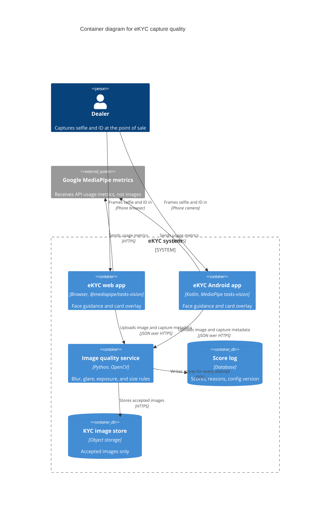

# Blur and glare detection for eKYC: what runs where

Earlier notes: [Blur detection at capture](2026-10-19-blur-detection-at-capture.md), [Blur detection build brief for web and Android](2026-10-19-blur-detection-web-android-build-brief.md), [Backend-only image quality scoring](2026-10-19-backend-only-image-quality-scoring.md), and [MediaPipe and free tools for capture quality](2026-10-20-mediapipe-and-free-tools-for-capture-quality.md).

## Short answer

The web and Android apps only guide the capture. MediaPipe keeps one face centred and at the right size, and a frame overlay or a contour check keeps the ID card in view. Neither app scores blur or glare.
The backend runs OpenCV on every uploaded selfie and ID image. It measures blur as the variance of the Laplacian and glare as the share of bright pixels inside the face or card area, then accepts the image or returns a retake reason.
All of it is free. The work is in the backend rules and in tuning separate selfie and ID thresholds from logged scores.

## How it works

The design splits the job in two. The apps help the dealer frame a usable shot. The backend decides whether the shot is sharp enough and free of glare.



The diagram shows four facts:

- MediaPipe runs inside each app.
- Images go only to your image quality service.
- Google receives MediaPipe usage metrics and no images, per the [MediaPipe Privacy Notice](https://github.com/google-ai-edge/mediapipe/blob/master/README.md).
- Rejected images do not reach the KYC image store.

### The apps guide the capture and do not score it

Guidance belongs on the phone because it has to react to every preview frame. A server round trip per frame is too slow for that.

MediaPipe gives the face guidance:

- Face Detector returns a bounding box, a confidence score, and 6 key points per face ([Face Detector overview](https://ai.google.dev/edge/mediapipe/solutions/vision/face_detector)). That is enough to check that one face is present, that it is large enough, and that it is centred.
- Face Landmarker adds 478 landmarks, 52 blendshape scores such as `eyeBlinkLeft` and `eyeBlinkRight`, and a facial transformation matrix ([Face Landmarker overview](https://ai.google.dev/edge/mediapipe/solutions/vision/face_landmarker); [Blendshape V2 model card](https://storage.googleapis.com/mediapipe-assets/Model%20Card%20Blendshape%20V2.pdf)). Use it if you want "open your eyes" and "face the camera" prompts. MediaPipe documents the matrix but not how to turn it into yaw, pitch, and roll, so that step is your own code.
- No MediaPipe task outputs a blur, sharpness, or glare score, and none detects ID documents. The full survey is in the [MediaPipe note](2026-10-20-mediapipe-and-free-tools-for-capture-quality.md).

The same models run on the web through `@mediapipe/tasks-vision` and on Android through `com.google.mediapipe:tasks-vision`, which needs Android SDK 24 or higher ([web setup](https://ai.google.dev/edge/mediapipe/solutions/setup_web); [Android setup](https://ai.google.dev/edge/mediapipe/solutions/setup_android)).

Document guidance needs a different tool, because MediaPipe has no document detector. The [Options](#options) section compares a plain overlay frame, jscanify, and your own OpenCV.js contour check.

Under this design, the apps do not compute blur scores, glare scores, or any other per-frame image quality score. That keeps one scoring implementation, one set of thresholds, and nothing on the client to tamper with. It costs live blur and glare feedback. A shaky or glary shot is found only after the upload, as the [backend-only note](2026-10-19-backend-only-image-quality-scoring.md) explains.

### Capture settings protect the backend score

The backend can only score what the app sends. Compression and downscaling change sharpness scores, so the apps must send a fixed, high-quality image.

- On Android, CameraX encodes JPEG at quality 95 in `CAPTURE_MODE_MINIMIZE_LATENCY` and at 100 in `CAPTURE_MODE_MAXIMIZE_QUALITY`, unless the app calls `setJpegQuality` ([CameraX `ImageCapture.Builder`](https://developer.android.com/reference/androidx/camera/core/ImageCapture.Builder)). Set the value explicitly.
- In the browser, `toBlob` and `toDataURL` take a quality from 0.0 to 1.0. Without one, the browser uses "an implementation-specific default" ([HTML Standard, canvas](https://html.spec.whatwg.org/multipage/canvas.html)). Pass the quality every time.
- Do not downscale before upload. Microblink gives the same advice for its server API ([Microblink on-prem image formats](https://docs.microblink.com/on-prem/image-formats)).
- Send the camera frame without filters or crops, and record the pixel size and the JPEG quality in the capture metadata.

### The backend pipeline decides

The image quality service runs these steps on every upload:

1. Decode the JPEG or PNG and apply the EXIF orientation. Reject an image that does not decode.
2. Normalise the size. Resize the region of interest to one fixed size before scoring. Gradient and Laplacian focus measures change with the size of the area they cover ([Pertuz, CVIA focus measure page](https://sites.google.com/view/cvia/focus-measure)), so scores from different phones are only comparable at one size.
3. Find the region of interest. For a selfie, run a face detector on the backend, either MediaPipe Python ([Python setup](https://ai.google.dev/edge/mediapipe/solutions/setup_python)) or OpenCV's YuNet detector, `cv::FaceDetectorYN` ([OpenCV DNN face tutorial](https://docs.opencv.org/4.x/d0/dd4/tutorial_dnn_face.html)). For an ID card, find a four-corner contour with `approxPolyDP` ([OpenCV contour features](https://docs.opencv.org/4.x/dd/d49/tutorial_py_contour_features.html)). Do not trust a face box sent by the app as the only source, because the client can be wrong or tampered with.
4. Score blur. Compute the variance of the Laplacian inside the region with `cv.Laplacian` and `cv.meanStdDev`, and square the standard deviation ([OpenCV Laplace tutorial](https://docs.opencv.org/4.x/d5/db5/tutorial_laplace_operator.html)). Tenengrad, the mean of the squared Sobel gradients, is an optional second measure ([earlier note, section on Tenengrad](2026-10-19-blur-detection-at-capture.md)).
5. Score glare. Build a mask of very bright pixels, by threshold on grey levels or by `inRange` on HSV for high value and low saturation ([OpenCV inRange tutorial](https://docs.opencv.org/4.x/da/d97/tutorial_threshold_inRange.html)). For 8-bit images, OpenCV stores H as 0 to 180 and S and V as 0 to 255 ([OpenCV colour conversions](https://docs.opencv.org/4.x/de/d25/imgproc_color_conversions.html)). The glare score is the share of masked pixels inside the region of interest, not inside the whole photo. A white wall behind the card is not glare.
6. Check exposure and resolution. Measure mean brightness and dark-pixel share in the region, and the short edge of the region in pixels.
7. Apply the rules for the image type, then return pass or fail with reason codes. Log every score.

DoT does not allow activation when the photo is "non-recognizable" ([DoT letter 800-09/2023-AS.II, 31.08.2023, as enclosed by Railway Board](https://telerb.railnet.gov.in/raw-attachment/wiki/UpLoads/CUGKYCInstruction.pdf)). Neither DoT nor any standard I found gives a numeric blur or glare threshold, so your thresholds come from your own data ([earlier note](2026-10-19-blur-detection-at-capture.md)).

### Validation rules

Selfies and ID cards need separate thresholds. A face has soft skin and few edges. A card has sharp printed text and a laminate that reflects light. Every threshold below reads "tune", because no source gives a number for eKYC. Where open-source code ships a default, the table names it as that code's default. Those defaults are not recommendations.

| Rule | Applies to | Measure | Threshold | Retake reason code |
|---|---|---|---|---|
| Image decodes | Both | JPEG or PNG decodes and has an orientation | Pass or fail | `BAD_IMAGE` |
| One face found | Selfie | Backend face detector count | Exactly 1 | `NO_FACE`, `MULTIPLE_FACES` |
| Card found | ID | Four-corner contour, area share of the frame | Tune | `DOC_NOT_FOUND` |
| Enough pixels | Both | Short edge of the face box or card, in pixels | Tune. kenlasko/monize uses 600 px for scanned documents | `LOW_RESOLUTION` |
| Sharp face | Selfie | Variance of the Laplacian on the resized face box | Tune for selfies. BlurDetection2 defaults to 100 | `BLUR` |
| Sharp card | ID | Variance of the Laplacian on the resized card area | Tune for ID cards. blurry-check defaults to 150, kenlasko/monize to 100 | `BLUR` |
| No glare on card | ID | Share of card pixels above a brightness level | Tune. blurry-check uses luminance 250 and a ratio of 0.08. The Smile ID web client counts grey levels at 240 or above against a percentage setting | `GLARE` |
| No glare on face | Selfie | Share of face pixels above a brightness level, for glasses and skin shine | Tune | `GLARE` |
| Not too dark | Both | Mean brightness of the region | Tune | `TOO_DARK` |
| Not washed out | Both | Mean brightness, or share of saturated pixels over the whole region | Tune | `TOO_BRIGHT` |

The defaults come from these files: [BlurDetection2 `detection.py`](https://github.com/WillBrennan/BlurDetection2/blob/master/blur_detection/detection.py), [blurry-check `blur-detector.ts`](https://github.com/i-DENVA/blurry-check/blob/main/src/blur-detector.ts), [blurry-check `constants.ts`](https://github.com/i-DENVA/blurry-check/blob/main/src/constants.ts), [Smile ID `useCardDetection.ts`](https://github.com/smileidentity/web-client/blob/main/packages/web-components/lib/components/document/src/document-auto-capture/hooks/useCardDetection.ts), and [kenlasko/monize `document-scan-quality.ts`](https://github.com/kenlasko/monize/blob/main/frontend/src/lib/document-scanner/document-scan-quality.ts).

### Roll out in log-only mode, then tune

Start with every rule in log-only mode. The service computes and logs all scores but accepts every image. Then join the logged scores with the outcomes you already have: OCR success, face match result, and manual review decisions. Set each cutoff where rejecting low scores removes the most failures for the fewest false rejects. NIST tests face quality measures in a similar way. It recomputes the false non-match rate after discarding the lowest-quality 1% and 5% of images ([NIST FATE Quality](https://pages.nist.gov/frvt/html/frvt_quality.html)). Turn rules to blocking one at a time. Keep a retry cap, and after it, allow a flagged submission for manual review so a dealer is never stuck.

### API contract

The apps call one endpoint per image. The request carries:

- the image bytes as captured,
- the image type, `selfie`, `id_front`, or `id_back`, and the document type,
- the attempt number,
- capture metadata: device model, OS or browser version, app version, camera facing, pixel size, and JPEG quality.

The response carries:

- `pass` or `fail`,
- the raw score for each check,
- a list of reason codes from the rules table,
- the threshold config version,
- an image ID for the log.

A response is a few fields:

```json
{"decision": "fail", "reasons": ["GLARE"],
 "scores": {"lapVar": 412.7, "glareRatio": 0.11},
 "configVersion": "id-2026-10-20.1", "imageId": "..."}
```

The apps map each reason code to a short prompt such as "Tilt the card away from the light". Keep that text in a table the server sends, so wording changes do not need an app release.

## Options

The design is fixed. These are the choices inside it.

### Document-in-frame guidance

| Option | What it does | Trade-off |
|---|---|---|
| Plain overlay frame | Draws a card-shaped outline and asks the dealer to fill it | No download and no detection. The app cannot tell whether the card is in the frame. The backend `DOC_NOT_FOUND` rule catches misses after the upload. |
| jscanify | `findPaperContour`, `getCornerPoints`, `highlightPaper`, and `extractPaper` find and highlight the card with OpenCV.js ([jscanify `src/jscanify.js`](https://github.com/puffinsoft/jscanify/blob/master/src/jscanify.js)). MIT licence, 1,781 stars and a last commit of 2026-07-20 on the GitHub API on 2026-10-20 ([jscanify repository](https://github.com/puffinsoft/jscanify)) | Live corner guidance with little code. It has no blur or glare score, which fits this design. It pulls OpenCV.js into the page, about 11 MB for 4.13.0 ([opencv.js 4.13.0](https://docs.opencv.org/4.13.0/opencv.js)). |
| Your own OpenCV.js or Android OpenCV contour check | The same `findContours` and `approxPolyDP` steps that the backend uses for the card area | One method on the client and the server. You write and tune it, and it carries the same OpenCV download. |

For a first release, the overlay frame is enough, because the backend card check covers it. Add jscanify if the logs show many `DOC_NOT_FOUND` rejects.

### Face guidance

| Option | Gives | Model size |
|---|---|---|
| Face Detector, BlazeFace short-range | Face count, size, and position | 229,746 bytes ([model file](https://storage.googleapis.com/mediapipe-models/face_detector/blaze_face_short_range/float16/1/blaze_face_short_range.tflite)) |
| Face Landmarker | The above, plus eyes open and head pose | 3,758,596 bytes ([model file](https://storage.googleapis.com/mediapipe-models/face_landmarker/face_landmarker/float16/1/face_landmarker.task)) |

The web app also loads the MediaPipe WASM, about 13.5 MB in `@mediapipe/tasks-vision` 1.1.1 ([npm tarball](https://registry.npmjs.org/@mediapipe/tasks-vision/-/tasks-vision-1.1.1.tgz)). Face Detector is the smaller start. Use Face Landmarker if closed eyes and turned heads show up in the reject logs.

### Backend face box for the selfie

| Option | Trade-off |
|---|---|
| MediaPipe Face Detector in Python | The same model as the apps. Apache 2.0 ([PyPI mediapipe](https://pypi.org/pypi/mediapipe/json)). |
| OpenCV YuNet, `cv::FaceDetectorYN` | Stays inside OpenCV ([FaceDetectorYN reference](https://docs.opencv.org/4.x/df/d20/classcv_1_1FaceDetectorYN.html)). The model in the OpenCV model zoo is MIT ([YuNet in opencv_zoo](https://github.com/opencv/opencv_zoo/tree/main/models/face_detection_yunet)). |

### Blur measure

| Measure | Trade-off |
|---|---|
| Variance of the Laplacian | One OpenCV call, used by every reference project above. Sensitive to noise and to region size. |
| Tenengrad | First derivatives, a useful second opinion. Also needs tuning. |
| scikit-image `blur_effect` | A 0 to 1 blur score, comparable only at the same `h_size` ([skimage.measure](https://scikit-image.org/docs/stable/api/skimage.measure.html)). |
| BSI OFIQ Sharpness | ISO/IEC 29794-5 face sharpness from Laplacian and Sobel features fed to a random-forest model ([OFIQ `Sharpness.cpp`](https://github.com/BSI-OFIQ/OFIQ-Project/blob/main/OFIQlib/modules/measures/src/Sharpness.cpp)). For selfies only, and a C++ integration. A later step. |

### Reference code to reuse

These files contain working blur or glare logic. Read them for the rules and the numbers. Do not copy a threshold without tuning it.

| Code | Language | What to take from it | Licence |
|---|---|---|---|
| [BlurDetection2 `detection.py`](https://github.com/WillBrennan/BlurDetection2/blob/master/blur_detection/detection.py) | Python | Variance of the Laplacian with a threshold, for the backend | MIT ([repository](https://github.com/WillBrennan/BlurDetection2)) |
| [OpenCV Laplace demo, Python](https://github.com/opencv/opencv/blob/5.x/samples/python/tutorial_code/ImgTrans/LaPlace/laplace_demo.py) and [HSV `inRange` demo, Python](https://github.com/opencv/opencv/blob/5.x/samples/python/tutorial_code/imgProc/threshold_inRange/threshold_inRange.py) | Python | The official calls for the blur and glare steps | Apache 2.0 ([OpenCV licence](https://opencv.org/license/)) |
| [blurry-check `blur-detector.ts`](https://github.com/i-DENVA/blurry-check/blob/main/src/blur-detector.ts) and [`constants.ts`](https://github.com/i-DENVA/blurry-check/blob/main/src/constants.ts) | TypeScript | A rule set with blur, glare, brightness, and per-mode settings for `id-card`, `passport`, and `profile-photo` | MIT ([repository](https://github.com/i-DENVA/blurry-check)) |
| [Smile ID `useCardDetection.ts`](https://github.com/smileidentity/web-client/blob/main/packages/web-components/lib/components/document/src/document-auto-capture/hooks/useCardDetection.ts) | TypeScript | An eKYC vendor's blur gate followed by a glare gate on ID cards, with retake messages | MIT ([repository](https://github.com/smileidentity/web-client)) |
| [OFIQ `Sharpness.cpp`](https://github.com/BSI-OFIQ/OFIQ-Project/blob/main/OFIQlib/modules/measures/src/Sharpness.cpp) | C++, with a Python wrapper ([OFIQ python README](https://github.com/BSI-OFIQ/OFIQ-Project/blob/main/python/README.md)) | Standards-based selfie sharpness, for later | Code MIT, models under their own licences ([OFIQ LICENSE.md](https://github.com/BSI-OFIQ/OFIQ-Project/blob/main/LICENSE.md)) |

blurry-check and the Smile ID web client run in the browser. This design reuses their rules on the backend, not their code in the apps.

## Development requirements

### Web app

- Add `@mediapipe/tasks-vision`. Serve its WASM and model files from your own origin, as the [MediaPipe web samples](https://github.com/google-ai-edge/mediapipe-samples-web/blob/main/copy-wasm.js) do for WASM.
- Run Face Detector or Face Landmarker on preview frames and show face prompts.
- Show the card overlay frame, or add jscanify.
- Export the still with an explicit JPEG quality and no downscaling.
- Handle the response. Show the retake prompt for that image only, count attempts, and offer a flagged submission after the cap.

### Android app

- Add `com.google.mediapipe:tasks-vision`, with min SDK 24 ([Android setup](https://ai.google.dev/edge/mediapipe/solutions/setup_android)).
- Feed CameraX analysis frames to the face model. Show the card overlay frame.
- Set `setJpegQuality` and do not resize before upload.
- Handle the response the same way as the web app.

### Backend

- Build the image quality service in Python with OpenCV: decode, normalise, find the region of interest, score, apply the rules, and respond.
- Add a backend face detector. Use MediaPipe Python or OpenCV YuNet.
- Store the rules and thresholds as a versioned config, with separate selfie and ID sections.
- Log every attempt with its scores, reason codes, config version, and capture metadata.
- Store accepted images only. Delete rejected images once the attempt is logged, unless you have a written purpose and period for keeping a tuning sample.

### Compliance

These points apply if the operator is an Indian telecom licensee. Confirm that first.

- MediaPipe processes images on the device. Processing of input images "takes place on device", and MediaPipe "does not send that input data to Google servers". The Tasks APIs do send usage metrics, and "You are responsible for obtaining informed consent from your app users" about them ([MediaPipe Privacy Notice](https://github.com/google-ai-edge/mediapipe/blob/master/README.md)). Add that metrics flow to your privacy notice.
- The model cards limit the use. The BlazeFace card lists "any form of surveillance or identity recognition" as out of scope and says the model is "not intended for human life-critical decisions" ([BlazeFace short-range model card](https://storage.googleapis.com/mediapipe-assets/MediaPipe%20BlazeFace%20Model%20Card%20%28Short%20Range%29.pdf)). This design uses the model as a framing aid, not for recognition. Have legal confirm that this use fits the card.
- The DPDP Act applies to every image. Section 8(2) requires a valid contract with processors. Section 8(5) requires reasonable security safeguards. Section 8(7) requires erasure once the purpose is served ([DPDP Act 2023](https://www.meity.gov.in/static/uploads/2024/06/2bf1f0e9f04e6fb4f8fef35e82c42aa5.pdf)). Rule 6 sets minimum safeguards and a one-year retention of access logs ([DPDP Rules 2025](https://www.meity.gov.in/static/uploads/2025/11/53450e6e5dc0bfa85ebd78686cadad39.pdf)). A rejected image has no KYC purpose once a better image passes, so delete it.
- Aadhaar images need masking. UIDAI tells requesting entities not to store Aadhaar copies without masking the first 8 digits ([UIDAI circular, 31 October 2022](https://uidai.gov.in/images/DosandDonots_for_Requesting_Entities.pdf)). Scoring runs on your own servers, so no third party sees the card. Never keep an unmasked rejected Aadhaar image for tuning.

## Resources needed

Every tool in this design is free. MediaPipe, OpenCV, the `opencv_zoo` YuNet model, and the reference code need no accounts or keys.

- Code and models: `@mediapipe/tasks-vision` and `com.google.mediapipe:tasks-vision`, the MediaPipe face model, `opencv-python` or `opencv-contrib-python` on the backend, and optionally jscanify on the web.
- Download weight on the web: about 13.5 MB of MediaPipe WASM plus 0.23 MB for Face Detector or 3.8 MB for Face Landmarker. jscanify adds about 11 MB of OpenCV.js. These figures are uncompressed sizes from the official hosts.
- Compute: the backend scoring runs on CPU. The MediaPipe face model runs on the dealer's phone.
- Data: a labelled set of real dealer selfies and ID images, sharp, blurred, and with glare, per ID type and per device class. Without it you cannot set thresholds.
- Devices: low-end dealer Android phones and their browsers.

Roles:

- A web developer and an Android developer for guidance, capture settings, and the retake flow.
- A backend developer for the service, the config, and the log.
- An engineer with image-processing experience to build the region-of-interest step and tune the rules.
- An analyst to set thresholds from the log.
- Legal and privacy review for the metrics notice, the model card scope, DPDP, and Aadhaar handling.

Effort is medium. The apps change little, because face guidance is one MediaPipe model and the card guidance can start as an overlay. The backend is where the work is. You build the region-of-interest step for two image types, write about ten rules, run log-only long enough to collect real scores, and tune two separate threshold sets. This size is a judgement, not a measured figure.

## Risks and open questions

Risks:

- The apps give no live blur or glare feedback. The dealer learns about a shaky or glary shot only after the upload. On slow links every retake costs upload time. Watch the retake rate per dealer in the log.
- Thresholds need tuning. No standard gives eKYC numbers. A threshold set on one phone model rejects good images from another. Tune per image type and check per device class.
- The region of interest can be wrong. If the backend misses the card contour, glare and blur are measured on the wrong pixels. Log the detected card area and review failures.
- Laminated cards can defeat the glare check. Laminate reflections can be small and bright inside the text area, or broad and pale. A single brightness threshold may miss pale glare or flag white card backgrounds. I did not test either case.
- The model card scope may not cover eKYC. Legal must confirm the framing-aid use.

Directions not explored:

- Performance of the MediaPipe face models and jscanify on low-end dealer phones. Google's published benchmarks are for a Pixel 6.
- Cutting OpenCV.js size with a custom build from `opencv_js.config.py` ([OpenCV.js build config](https://github.com/opencv/opencv/blob/4.x/platforms/js/opencv_js.config.py)). Only relevant if you add jscanify.
- Browser coverage. MediaPipe's web setup names Chrome and Safari only ([web setup](https://ai.google.dev/edge/mediapipe/solutions/setup_web)). Samsung Internet, Android WebView, and Firefox are untested.
- Glare detection on laminated and holographic cards, including whether HSV or grey-level masks work better on Indian ID types.

Open questions:

- Which ID types do you accept, and do you capture both sides?
- What are upload times at rural points of sale?
- How long can log-only mode run before blocking starts?
- Does DoT require you to keep rejected capture attempts? I found no rule either way.

## Sources

All accessed 2026-10-20.

Earlier notes in this folder

- [Blur detection at capture](2026-10-19-blur-detection-at-capture.md)
- [Blur detection build brief for web and Android](2026-10-19-blur-detection-web-android-build-brief.md)
- [Backend-only image quality scoring](2026-10-19-backend-only-image-quality-scoring.md)
- [MediaPipe and free tools for capture quality](2026-10-20-mediapipe-and-free-tools-for-capture-quality.md)

MediaPipe

- MediaPipe README, Privacy Notice. https://github.com/google-ai-edge/mediapipe/blob/master/README.md
- MediaPipe web samples, copy-wasm.js. https://github.com/google-ai-edge/mediapipe-samples-web/blob/main/copy-wasm.js
- Face Detector overview. https://ai.google.dev/edge/mediapipe/solutions/vision/face_detector
- Face Landmarker overview. https://ai.google.dev/edge/mediapipe/solutions/vision/face_landmarker
- Setup guide for web. https://ai.google.dev/edge/mediapipe/solutions/setup_web
- Setup guide for Android. https://ai.google.dev/edge/mediapipe/solutions/setup_android
- Setup guide for Python. https://ai.google.dev/edge/mediapipe/solutions/setup_python
- Blendshape V2 model card. https://storage.googleapis.com/mediapipe-assets/Model%20Card%20Blendshape%20V2.pdf
- BlazeFace short-range model card. https://storage.googleapis.com/mediapipe-assets/MediaPipe%20BlazeFace%20Model%20Card%20%28Short%20Range%29.pdf
- BlazeFace short-range model file. https://storage.googleapis.com/mediapipe-models/face_detector/blaze_face_short_range/float16/1/blaze_face_short_range.tflite
- Face Landmarker model file. https://storage.googleapis.com/mediapipe-models/face_landmarker/face_landmarker/float16/1/face_landmarker.task
- npm, @mediapipe/tasks-vision 1.1.1 tarball. https://registry.npmjs.org/@mediapipe/tasks-vision/-/tasks-vision-1.1.1.tgz
- PyPI, mediapipe. https://pypi.org/pypi/mediapipe/json

OpenCV and other tools

- OpenCV licence. https://opencv.org/license/
- OpenCV, Laplace Operator tutorial. https://docs.opencv.org/4.x/d5/db5/tutorial_laplace_operator.html
- OpenCV, Thresholding Operations using inRange. https://docs.opencv.org/4.x/da/d97/tutorial_threshold_inRange.html
- OpenCV, Color conversions. https://docs.opencv.org/4.x/de/d25/imgproc_color_conversions.html
- OpenCV, Contour Features. https://docs.opencv.org/4.x/dd/d49/tutorial_py_contour_features.html
- OpenCV, DNN-based Face Detection and Recognition. https://docs.opencv.org/4.x/d0/dd4/tutorial_dnn_face.html
- OpenCV, cv::FaceDetectorYN class reference. https://docs.opencv.org/4.x/df/d20/classcv_1_1FaceDetectorYN.html
- OpenCV model zoo, YuNet face detection. https://github.com/opencv/opencv_zoo/tree/main/models/face_detection_yunet
- OpenCV, opencv.js 4.13.0. https://docs.opencv.org/4.13.0/opencv.js
- OpenCV, opencv_js.config.py. https://github.com/opencv/opencv/blob/4.x/platforms/js/opencv_js.config.py
- OpenCV sample, laplace_demo.py. https://github.com/opencv/opencv/blob/5.x/samples/python/tutorial_code/ImgTrans/LaPlace/laplace_demo.py
- OpenCV sample, threshold_inRange.py. https://github.com/opencv/opencv/blob/5.x/samples/python/tutorial_code/imgProc/threshold_inRange/threshold_inRange.py
- scikit-image, skimage.measure. https://scikit-image.org/docs/stable/api/skimage.measure.html
- BSI OFIQ, Sharpness.cpp. https://github.com/BSI-OFIQ/OFIQ-Project/blob/main/OFIQlib/modules/measures/src/Sharpness.cpp
- BSI OFIQ, python/README.md. https://github.com/BSI-OFIQ/OFIQ-Project/blob/main/python/README.md
- BSI OFIQ, LICENSE.md. https://github.com/BSI-OFIQ/OFIQ-Project/blob/main/LICENSE.md
- Pertuz, CVIA Focus Measure project page. https://sites.google.com/view/cvia/focus-measure
- NIST, FATE Quality. https://pages.nist.gov/frvt/html/frvt_quality.html

Reference code

- WillBrennan/BlurDetection2. https://github.com/WillBrennan/BlurDetection2
- BlurDetection2, blur_detection/detection.py. https://github.com/WillBrennan/BlurDetection2/blob/master/blur_detection/detection.py
- i-DENVA/blurry-check. https://github.com/i-DENVA/blurry-check
- blurry-check, src/blur-detector.ts. https://github.com/i-DENVA/blurry-check/blob/main/src/blur-detector.ts
- blurry-check, src/constants.ts. https://github.com/i-DENVA/blurry-check/blob/main/src/constants.ts
- smileidentity/web-client. https://github.com/smileidentity/web-client
- Smile ID web client, useCardDetection.ts. https://github.com/smileidentity/web-client/blob/main/packages/web-components/lib/components/document/src/document-auto-capture/hooks/useCardDetection.ts
- puffinsoft/jscanify. https://github.com/puffinsoft/jscanify
- jscanify, src/jscanify.js. https://github.com/puffinsoft/jscanify/blob/master/src/jscanify.js
- kenlasko/monize, document-scan-quality.ts. https://github.com/kenlasko/monize/blob/main/frontend/src/lib/document-scanner/document-scan-quality.ts

Capture settings

- Android Developers, ImageCapture.Builder. https://developer.android.com/reference/androidx/camera/core/ImageCapture.Builder
- WHATWG, HTML Standard, canvas element. https://html.spec.whatwg.org/multipage/canvas.html
- Microblink, on-prem image formats. https://docs.microblink.com/on-prem/image-formats

Regulators and law (India)

- DoT letter 800-09/2023-AS.II dated 31.08.2023, as enclosed in Railway Board letter dated 12.09.2024. https://telerb.railnet.gov.in/raw-attachment/wiki/UpLoads/CUGKYCInstruction.pdf
- MeitY, Digital Personal Data Protection Act, 2023. https://www.meity.gov.in/static/uploads/2024/06/2bf1f0e9f04e6fb4f8fef35e82c42aa5.pdf
- MeitY, Digital Personal Data Protection Rules, 2025. https://www.meity.gov.in/static/uploads/2025/11/53450e6e5dc0bfa85ebd78686cadad39.pdf
- UIDAI, Circular on Dos and Don'ts for Requesting Entities, 31.10.2022. https://uidai.gov.in/images/DosandDonots_for_Requesting_Entities.pdf
